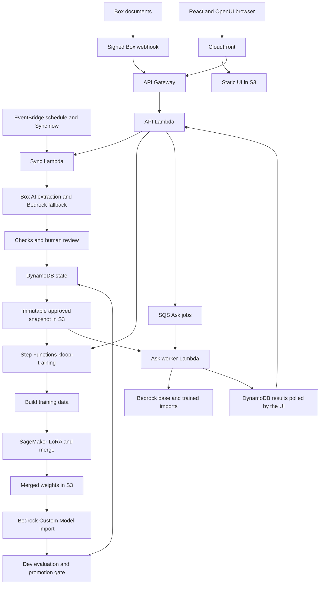

# Knowledge Loop — Box + AWS

Knowledge Loop tests whether an AI can learn from an organization's Box documents.
Document changes become reviewed facts and procedures, which feed a Qwen3-4B
LoRA training run on SageMaker. Merged weights are imported into Amazon Bedrock.
The React/OpenUI app compares three answers to the same question:

| Mode | What it uses |
| --- | --- |
| Without learning | Base Qwen3-4B-Instruct-2507, without document retrieval |
| Trained | The selected trained import, without document retrieval |
| Search | Base model with retrieved, approved source evidence and citations |

**Demo status, recorded 17 October 2026:** medical v1-partial serves as an explicitly
rejected preview. Its sealed hidden-set score is lower than the base model's.
This demonstrates the learning pipeline and its failure cases, not a successful
quality improvement. Medical answers are observations from the demo corpus, not
clinical guidance.

## Architecture

See [the architecture guide](docs/ARCHITECTURE.md) for component boundaries, request flows, training, and promotion safeguards.



The selected Region is **us-east-2**, using AWS profile **box-hackathon**.
Webhooks are signature checked and deduplicated; a one-minute schedule and
**Sync now** share the sync path. Extraction preserves source file/version
references. Review publishes immutable snapshots. Training freezes its input,
restarts from base, imports merged weights, and runs a separate dev gate before
changing the current serving version. Ask jobs pin their model and snapshot so
polling can outlast the API request timeout.

The app uses a shared password, a signed secure session cookie, origin/CSRF
checks, and a CloudFront origin header. Secrets are resolved at runtime through
Secrets Manager; they are not Terraform inputs. See [infra/README.md](infra/README.md)
for state, IAM, packaging, and cleanup details.

## Repository layout

| Path | Purpose |
| --- | --- |
| `kloop/` | Schemas, storage adapters, Box integration, sync, extraction, training, evaluation, answers, and API services |
| `web/` | React/OpenUI frontend, unit tests, and browser tests |
| `lambdas/` | API, sync, and asynchronous Ask entry points |
| `infra/` | Terraform, Step Functions definitions, and locked Lambda dependencies |
| `training/` | SageMaker training and weight merge code |
| `scripts/` | Linux Lambda packaging and infrastructure commands |
| `tests/` | Credential-free Python tests with memory adapters and AWS mocks |
| `poc/` | Experiments, frozen evaluation metadata, and historical evidence; sealed material is evaluator-only |
| `pack/` | Original fictional Halvard company pack and validation |

## Local setup and checks

Install Python **3.12**, uv, and Node.js/npm. AWS work additionally requires AWS
CLI v2 and Terraform **>=1.10, <2.0**. Run from the repository root:

```sh
uv sync --locked
npm ci --prefix web --no-audit --no-fund
make test
make lint
make web-test
make pack-check
make web-build
```

`make test` runs `uv run --locked pytest`; `make lint` runs Ruff checks and a
format check. `make format` applies formatting and lint fixes. Frontend unit
tests use Vitest. Python tests do not need cloud credentials. Live smoke tests,
evaluation, seeding, and training are separate operations and may incur costs.

## Deployment

Confirm the selected Region in **AWS Settings > View all projects > Overview >
Additional Info > Region**. Use the existing browser-based AWS login for profile
`box-hackathon`; do not copy access keys into the repository. Before creating
resources, confirm the project's plan and spend status in **AWS Settings >
Billing**, and agree whether resources should be retained or cleaned up afterward.

For a fresh, explicitly approved full deployment, the Makefile exposes:

```sh
make bootstrap
make plan
make deploy
make infra-smoke
```

`AWS_PROFILE` defaults to `box-hackathon`; `NAME_PREFIX` defaults to `kloop`.
Keep the same prefix and bootstrap state throughout a deployment. `make build`
builds the static UI and a Linux x86_64/Python 3.12 Lambda ZIP; `make deploy`
applies Terraform, uploads assets before HTML, invalidates the index, and waits
for CloudFront. This is a full deployment, not a worker-only release command.

### Updating the reserved demo

The demo deliberately runs selected artifacts from different tested revisions.
The branch tip is not a description of every deployed component. Follow the
coordinator's current release window and the workspace deployment runbook; do
not run a broad apply against an active training or evaluation workflow.

1. Record the approved source commit and affected component. Run its offline
   checks; preserve the exact deployed ZIP, revision, environment, and rollback
   artifact privately. Check all job readers and writers for schema compatibility.
2. For a narrow worker change, patch only the approved files into that exact
   deployed archive. Verify every other ZIP entry is byte-identical. Update only
   that Lambda with its expected revision, preserve configuration, and check
   successful status and the deployed archive hash. Updating the whole package
   from the branch can introduce incompatible schemas.
3. For a static-only change, build the approved frontend, publish hashed assets
   before HTML, set HTML non-cacheable, invalidate `/` and `/index.html`, and
   verify the public bytes. Keep held controls out of the released UI.
4. The assigned deployment/browser owner checks login, serving label, and one
   real Trained plus Search response, respecting shared rate limits. A static or
   auth smoke alone does not prove model serving, training, or learning quality.
5. Record exact hashes, changed files, checks, and rollback revision in the
   deployment runbook. Keep API, evaluation, sync, Step Functions, IAM, model
   binding, and other held components unchanged unless separately cleared.

The 19:07 UTC handoff records a staged worker guard using the per-version
`manual_promotion_approval` flag: a passing candidate awaits approval, stays
retained, and leaves the current pointer unchanged. That guard is not yet claimed
live. Verify its deployed artifact before releasing its evaluation hold. Never
auto-promote or switch the demo binding without explicit approval.

`make infra-smoke` checks static/auth/origin/serving access and reads the auth
secret in memory; it does not invoke models. `make box-smoke` and
`make answer-smoke` are live checks and require separate ownership/clearance.
`make destroy` is destructive: it fences creators and drains only the owned
cleanup ledger. Do not use it during the reserved demo, or delete retained base
or medical imports without approval.

## Running the demo

Open **https://dds5m3yqphe4h.cloudfront.net**. An authorized human can retrieve the
shared password in a private terminal with:

```sh
aws secretsmanager get-secret-value \
  --profile box-hackathon --region us-east-2 \
  --secret-id kloop/auth --query SecretString --output text
```

This command displays the secret. Enter it only in the login form; keep its output
out of chat, screenshots, logs, and commits. Cookie signing uses the separate
`kloop/cookie-signing` secret. Box credentials are stored separately in
`box-hackathon/box-ccg`.

- Check the Trained label before comparing. The retained preview is **Medical
  v1-partial (rejected at dev gate)**; serving is not promotion. Upload, review,
  training, version-loading, and Results features in source may be ahead of the
  deliberately limited live release.
- Arrange warm-up about **30 minutes before** presenting. Imports can take minutes
  to become ready; asynchronous cards may report warming while jobs continue.
  Do not resubmit an existing question to make it finish sooner.
- One owner controls warming. The recorded demo keep-warm plan invokes the base
  and retained medical import directly every **4 minutes**, with a trivial prompt,
  at most **5 output tokens**, one attempt, and success/failure logs only. It stops
  at **22:15 UTC on 17 October 2026**. This is a bounded demo arrangement, not a
  permanent service. Do not add concurrent browser warm-ups while it is active.
- When no owner is warming, the **Warm up** control is the operator path. Wait
  until its jobs are terminal before starting another warm-up.
- The shared limit is **6 comparisons per fixed UTC minute per observed source
  IP**. Warm up shares that counter across sessions; denied attempts increment it.
  For browser checks, pace at **3 or fewer per minute** and wait a full **60 seconds**
  after HTTP 429 before retrying. Poll existing jobs rather than creating duplicates.
- Show Sources, reviewed evidence, the three answer modes, and Results. A changed
  Box document affects Search after sync/review; Trained needs a new training
  version. If showing a pre-trained replacement, disclose the playback explicitly.

Use the operator's approved demo questions. Do not expose sealed hidden questions
or use them to tune a demo. Selected examples can show recall but do not overturn
aggregate evaluation results.

## Evaluation and observed results

The **dev set** is the promotion gate. The **sealed hidden set** is separate,
hashed, and reserved for reporting; its question text must not enter training,
prompts, public documentation, or demo preparation. Automatic checks and a blinded
Bedrock judge score outputs. Public reports can expose aggregate counts and hashes.

Recorded medical v1-partial hidden results (150 questions per mode):

| Mode | Correct | Score |
| --- | ---: | ---: |
| Without learning | 56/150 | 37.3% |
| Trained | 50/150 | 33.3% |
| Search | 62/150 | 41.3% |

**Medical v1 was rejected at the dev gate and remains unpromoted.** The recorded
dev totals were 25/60 Trained versus 24/60 base, with abstention regressions; the
small overall increase did not satisfy the gate. Its partial recipe used 2,349
rows, no near-miss rows, and a disclosed replay-check omission. A separate medical
v2 retrain was in progress at the documentation checkpoint; no v2 quality result
is claimed here. These numbers come from the recorded evaluation/browser handoff,
not a new run performed for this README.

## Known limitations

- Exact numbers, dates, multi-fact answers, and procedures can be hallucinated or
  omitted. A plausible answer or one selected success does not prove learning.
- Search has returned leftover Halvard material in medical answers. Inspect the
  actual cited source/version; retrieved text is not automatically relevant.
- The training data builder still imports the original Halvard system prompt.
  This mismatch can contaminate medical behavior and is not fixed by this README.
- Cold starts can take several minutes. Generation time excludes queue/warm-up
  time; historical records may lack total or component timings.
- The project's Bedrock import quota is **3**. Base, current, and candidate must
  fit within it; unloading/reimporting requires explicit coordination and retained
  weights. A completed import does not prove it can serve.
- The demo deployment is intentionally partial. A passing local test or checked-in
  control does not mean the matching API, workflow, or UI is deployed.
