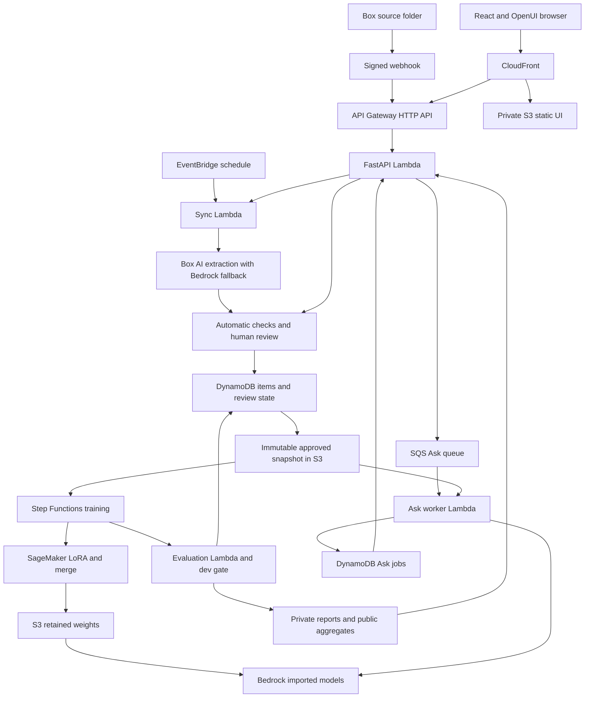
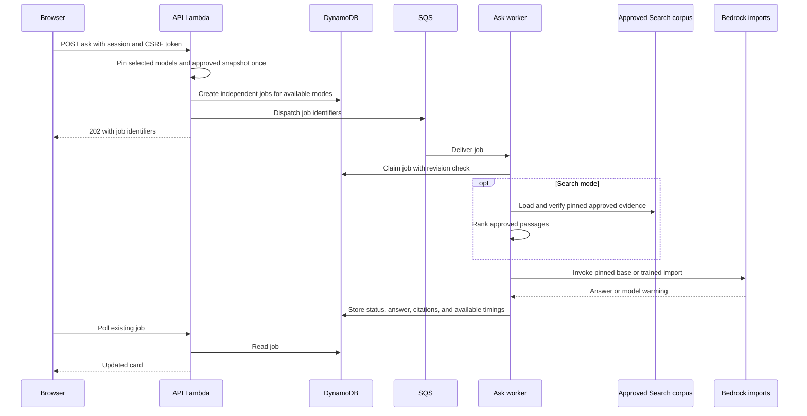
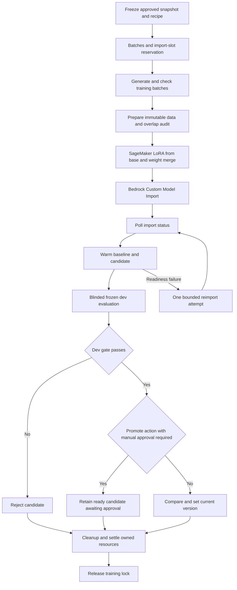

# Continuous Learning Loop architecture

Continuous Learning Loop (code and resource names keep the `kloop` prefix) tests whether a small model can learn an
organization's knowledge from Box documents. The live app header still reads "Halvard Systems · Knowledge loop";
the UI is unchanged before the demo. Halvard
Systems is the fictional company used for the original pack; the later medical corpus exercises the same
loop at a larger scale. Documents become reviewed facts and procedures, then training examples, merged model
weights, a Bedrock import, and a measured promotion decision.

The browser compares **Without learning**, **Trained**, and **Search** to separate learned weights from
retrieved evidence. A working pipeline alone does not prove quality improved.

## Scope and deployment checkpoint

This document describes source at `650216ead3efb762b23b382e975e37c9ffde2df6` and recorded deployment
handoffs on 17 October 2026. It is not a live inventory. All project Regional resources use **us-east-2**,
with profile **box-hackathon**. CloudFront is global. Confirm the selected Region in **AWS Settings > View
all projects > Overview > Additional Info > Region** before resource operations.

The reserved demo runs selected artifacts from different revisions:

- The serving preview is **Medical v1-partial (rejected at dev gate)**. Serving it
  does not change its rejected status or the training promotion pointer.
- The recorded Ask release uses a narrow snapshot-cache backport with the older
  strict job schema. The source's Box hybrid retrieval and additional timing
  fields must not be assumed live.
- The manual promotion guard (worker archive `f0f850cd`) was staged at the
  **12:07 PM PDT** handoff and is live on `kloop-training-worker` since **12:31 PM
  PDT**. A passing candidate with `manual_promotion_approval` is retained as
  `awaiting_approval` and the promotion pointer is left unchanged.
- Full API, version-loading controls, and other held components need separate
  release approval. The loading worker Lambda and `kloop-loading` state machine
  exist only in Terraform source; the deployment has one state machine,
  `kloop-training`.
- A medical v2 training execution was running at the checkpoint. No result from it
  is claimed here.

## System overview

Python 3.12 implements application services and Lambda entry points; Terraform defines infrastructure. The
static browser app uses React/OpenUI for chat and exposes Sources, Review, Training, and Results alongside
the three answer cards. Services use shared schemas and injected storage/model interfaces, allowing
credential-free tests with memory adapters.

Deployed Lambdas are `kloop-api`, `kloop-sync`, `kloop-ask` (SQS consumer, batch size 1), `kloop-evaluation`,
and `kloop-training-worker`; `kloop-training` is a placeholder handler because the API starts the
`kloop-training` Step Functions execution directly.

## Models

| Role | Model | Where |
| --- | --- | --- |
| Document extraction | Claude 4.5 Haiku (`aws__claude_4_5_haiku`) through Box AI Extract Structured | `kloop/extract/provider.py` |
| Extraction fallback, training-row checker, evaluation judge | GLM-5 (`zai.glm-5`, Bedrock us-east-2) | `kloop/extract/provider.py`, `kloop/train/helpers.py`, `kloop/eval/judge.py` |
| Training Q/A wording and medical question generation | Kimi K3 (`us.moonshotai.kimi-k3` US cross-Region inference profile) | `kloop/train/helpers.py`, `kloop/eval/build_medical.py` |
| Learned model | Qwen/Qwen3-4B-Instruct-2507, LoRA on one `ml.g5.2xlarge`, merged and imported to Bedrock | `kloop/train/config.py`, `kloop/train/job.py` |

Bedrock imports at the checkpoint: base `0inmdc8ttj1w` (`box-hackathon-poc1-base-20261017-32k`) and medical v1
`na5g3za8q4u5` (`kloop-e33b17d052b97e095be8dc7c-r1`, the reimport attempt). **Known issue:** the Kimi K3
inference profile may route requests to other US Regions, and `infra/training.tf` grants
`arn:aws:bedrock:us-*::foundation-model/moonshotai.kimi-k3` for that; this is the one exception to the
us-east-2-only rule. All other model calls stay in us-east-2.

### Model usage

| When | Calls | Limits from code |
| --- | --- | --- |
| Sync finds a new or changed file version | One Box AI Extract Structured call (Claude 4.5 Haiku) per changed file version; unchanged cursors are skipped. GLM-5 is called only when the Box AI call raises a Box API error. | ≥2 s pacing between Box AI calls; source text ≤1,000,000 bytes; GLM-5 fallback `maxTokens` 4096, temperature 0 |
| Each **Compare** (Ask) | 3 imported-model invocations: base alone, trained alone, base plus the top-3 approved passages. One SQS job per mode. | `max_gen_len` 256, temperature 0; while a model is warming the worker retries with backoff for 240 s by default (≤840 s); 6 Compare/Warm-up requests per minute per IP |
| **Warm up** | One job that sends a 16-token "READY" probe to the base import, then the trained import. | Shared warm-up lease; same 6/min counter |
| Recorded keep-warm loop | Direct invocations of the base and medical imports every 4 minutes with a trivial prompt (README). | ≤5 output tokens, one attempt; stops 22:15 UTC (3:15 PM PDT) |
| **Train now**, generation phase | One Kimi K3 batch per approved item (4 fact wordings or 8 procedure cases) plus control batches of 20 rows (deployed recipe: 400 unknown → 20 batches, 220 near-miss → 11). Each batch is 1 Kimi K3 call + 1 GLM-5 review call, with up to 2 repair rounds (Kimi K3 + GLM-5 each) and up to 3 parse retries. Replay rows (490) are deterministic and make no model call. Results are cached in S3 so a retried execution does not re-spend. | Kimi K3 `max_tokens` 6000 (item) / 12000 (control), prefix-cached prompts; GLM-5 review 1024 / 4096; helper budget default $30, deployed cap $75 (`le=75`), metered in nano-dollars at the Kimi K3 / GLM-5 rates in `kloop/train/budget.py`; a crossed budget stops before GPU training |
| **Train now**, prepare phase | One GLM-5 semantic check per accepted training row (deployed expectation: 2,686 rows). | 256 output tokens; a rejection fails the run |
| **Train now**, GPU and import | One SageMaker training job (LoRA + merge) and one Bedrock Custom Model Import per version, plus at most one reimport. | `ml.g5.2xlarge`, 3 epochs, max runtime 5,400 s (deployed env) |
| Dev gate, per training run | Two imported-model answers per dev question (current/base in `without`, candidate in `with`), then GLM-5 judging in batches of 10 answers, two passes (whole-answer rubric and criteria rubric), with shuffled opaque identifiers. | Judge `maxTokens` 3072, temperature 0; answers use the Ask limits above |
| Hidden-set report (operator-run, not automatic) | Three imported-model answers per hidden question (`without`, `with`, `search`), judged the same way. | Same limits; 150 questions per mode in the recorded report |
| Medical dataset build (one-time) | Kimi K3 generates candidate questions per source batch; GLM-5 screens them. | Kimi K3 `max_tokens` 10,000; GLM-5 3,000 |

## Documents, review, and immutable knowledge

The Box client uses client-credentials authentication scoped to the configured source folder. Sync
recursively lists that folder, skips the Reports subtree and JSON exports, and compares file/version cursors
before extracting changed files. A complete listing precedes deletion inference so a partial scan cannot
retire unseen sources. The same sync service handles webhooks, scheduled reconciliation, and authenticated
**Sync now** requests.

Webhook ingress verifies signatures and delivery age, records durable deduplicated receipts, and dispatches
sync. It does not trust event metadata as authority to delete knowledge: the worker checks the configured
folder. Pending receipts allow scheduled reconciliation after a crash between receipt and completion.
Terraform defines a one-minute EventBridge Scheduler schedule whose default is disabled
(`sync_enabled = false`); the recorded deployment runs it enabled with the Sync Lambda
unreserved.

Extraction first asks Box AI for a structured table using pinned source-version text. A Box API failure can
use the explicit regional Bedrock GLM-5 fallback. Rows retain subject, stable attribute identity, supporting
quote, source file and version, and procedure conditions/steps. Checks identify missing fields, quotes
absent from the source, duplicates, conflicts, and retirements. Review modes `off`, `exceptions`, and `all`
determine which valid proposals need human review.

Approval/edit/rejection updates state with concurrency checks. A pending upsert cannot be approved after its
source is deleted or its proposal is superseded. Retirement is a reviewable change; source deletion is not
an automatic promotion or an automatic rewrite of a model's weights.

An approved snapshot contains only approved items, ordered and hashed. S3 stores the canonical JSON body
under its content hash; DynamoDB holds a small pointer with the object key, format, and body hash. Reads
verify pointer, bytes, canonical encoding, and item hash. Conditional S3 writes reject different bytes at an
existing key. Training and Ask use the snapshot adapter rather than treating the DynamoDB pointer as the
full document.

## Storage and service boundaries

| Store or service | Responsibility |
| --- | --- |
| Box | Versioned source documents and aggregate report copies |
| DynamoDB | Items/reviews, sync cursors/receipts, versions/current pointer, reports, Ask jobs, locks, cleanup ledger |
| Artifact S3 bucket | Approved snapshots, Search corpora, immutable training data/manifests, retained weights, evaluation artifacts |
| Web S3 bucket | Built static UI, accessed through CloudFront origin access control |
| SQS and dead-letter queue | Durable Ask dispatch and failed-delivery isolation |
| Step Functions Standard | Bounded training transaction (`kloop-training`, deployed); separate model-loading workflow (source only) |
| Secrets Manager | Runtime password, cookie signing, origin guard, Box credentials/webhook keys |
| CloudWatch | Operational logs; Terraform sets seven-day retention for defined log groups |

DynamoDB uses `pk`/`sk` keys and on-demand billing; Ask jobs and webhook dedupe records have TTLs.
Application deadlines enforce job expiry without relying on immediate TTL deletion. Both application S3
buckets block public access and use SSE-S3 encryption. Sealed evaluation artifacts have a separate IAM read
boundary.

## Ask request flow

| Mode | Model and context |
| --- | --- |
| Without learning (`without`) | Pinned base Qwen3-4B-Instruct-2507 import; no retrieval |
| Trained (`with`) | Selected loaded version, current promoted version, or explicitly labelled temporary preview; no retrieval |
| Search (`search`) | Same base import plus approved, versioned source passages |

The worker claims jobs conditionally, avoids invoking again for duplicate running or terminal deliveries,
and records warming while bounded readiness retries run. Polling continues independently of the short API
request. Warm up uses the same queue, pins base then trained, and acquires a shared warm-up lease.

Search loads a snapshot-bound S3 corpus and verifies its index against approved sources. A missing corpus
permits version-pinned Box document fetches; corruption fails closed. The local BM25 index chunks **only
approved supporting-quote ranges**, with source offsets and filename boosts. It does not index every
sentence in a document simply because one fact from that document was approved.

In the checked-in `box_hybrid` mode, one folder-scoped Box Search request narrows eligible file/version
pairs before local ranking. Empty, unavailable, throttled, or unusable Box results fall back to the local
approved index. Retrieved Box hits cannot add unapproved content. `local` mode skips the Box Search request
entirely. The model receives the top passages with citation labels; only referenced labels become returned
citations. A citation establishes provenance, not full entailment.

## Training and promotion

**Train now** freezes input once and uses a deterministic request/version identity. The current-approved
path derives a revision from the latest approved snapshot; explicit medical runs can pin a selected
immutable snapshot instead. Retries reuse the same execution rather than silently choosing new knowledge.
The manifest binds snapshot, recipe, dev-set hash, expected current version, data hash, and row counts.

The worker generates checked fact/procedure wordings plus configured unknown, near-miss, and replay rows.
Durable batches, helper caching, count checks, budget checks, and the medical evaluator's sealed overlap
audit precede GPU training. Partial-input recipes and authorized omissions are recorded as deviations.

The default GPU is **one `ml.g5.2xlarge`** running LoRA on **Qwen/Qwen3-4B-Instruct-2507**; configuration
also permits `ml.g6.2xlarge`. Each version starts from base weights. The SageMaker job merges the adapter
into full safetensors and uploads retained weights and hashes to S3. Bedrock Custom Model Import creates the
serving artifact; no SageMaker inference endpoint is used. Import completion is followed by warm-up and
actual dev evaluation, not treated as proof of readiness or quality.

The gate requires identical complete frozen dev sets, a strict overall gain meeting the recipe threshold,
and no new failures on previously correct untold/unrelated cases. Ordinary promotion uses compare-and-set
against the expected current version. With `manual_promotion_approval` set, the checked-in worker returns
`awaiting_approval`, retains the ready candidate, and leaves the pointer unchanged. Cleanup also preserves
explicitly retained rejected medical candidates. These guards do not themselves authorize a human approval
or a demo binding change.

Success and failure converge on cleanup, then lock release only after resource activity settles.
Abort/timeout recovery reconciles owned work; unresolved cleanup keeps ownership. Creators reserve
cleanup-ledger entries before external creation. Deletion requires ledger ownership and matching deployment
protection checks.

## Version loading under the three-import limit

This project's recorded Bedrock import quota is **3**. Retained S3 weights let a version be reimported
without retraining. Explicit load uses a separate Standard workflow (defined in `infra/loading.tf`, not
deployed), verifies recovery weights, checks capacity, imports, warms, then exposes the loaded version for
selection. Explicit loading refuses automatic eviction; the operator must choose an eligible unload when
capacity is full.

Unload protects base/current models and active Ask/evaluation users, requires a deployment-owned import, and
removes the version from new Ask selection before asynchronous deletion. Loading a rejected version does not
promote it. The live demo's protected base and medical imports must not be unloaded without approval.

## Evaluation, Results, and observed limits

The evaluator has a separate role for sealed S3 reads. Training calls an overlap audit over immutable
training bytes; it receives only the outcome/hash, never hidden questions. The dev set controls promotion;
the sealed hidden set is for reporting. A Bedrock judge receives shuffled opaque answer identifiers without
model/mode labels, with exact output-schema validation. Automatic required-value checks and rubric
diagnostics complement whole-answer scoring.

Raw hidden answers and judge details remain evaluator-private. Aggregate reports go to S3, DynamoDB, and
Box; `/api/results` allowlists public fields. Results shows scores, category counts, paired comparisons,
gate status, hashes/bindings, and recipe caveats without rendering sealed question text.

Recorded medical v1-partial results, **150 hidden questions per mode**:

| Without learning | Trained |
| ---: | ---: |
| 56/150 (37.3%) | 50/150 (33.3%) |

Medical v1 was **rejected at the dev gate and remains unpromoted**. Recorded dev totals were 25/60 Trained
versus 24/60 base, with abstention regressions. Its partial recipe used 2,349 rows, omitted near-miss rows,
and disclosed a replay-check omission. These are handoff results, not a new evaluation for this document. No
medical v2 quality result is claimed.

Cold model readiness can consume the **15-minute** (900 s) worker window and may still fail; reimport is
bounded. Small-model answers can invent numbers/dates, miss procedure branches, or mix domains. The original
Halvard system prompt is still shared with medical training/inference. Search coverage is limited to
approved quotes. Generation latency excludes parts of user
wait time; older jobs lack component timings.

## Security and operations

The app uses a shared password and an HMAC-signed, one-hour `__Host-kloop` cookie with Secure, HttpOnly,
SameSite Strict, and root path attributes. Mutating browser requests require the exact public Origin and a
session-bound CSRF token; login requires Origin. Box webhooks use signature authentication instead of
sessions. CloudFront supplies an origin guard header, checked before route handling; this guard supplements
session checks. API responses are non-cacheable.

Atomic DynamoDB throttles use fixed UTC minute buckets per observed source IP: **6/minute shared by Ask and
Warm up**, **120/minute for other API requests**, and **10/minute for login**. Webhooks use their separate
signature/deduplication path. The application trusts API Gateway's source-IP field, not a caller's
forwarding header. Separate API Gateway limits also apply. For browser verification, use at most 3
comparisons/minute and back off a full minute after HTTP 429.

Secret names are `kloop/auth`, `kloop/cookie-signing`, `kloop/origin`, and `box-hackathon/box-ccg`
(including webhook keys). Values are resolved at runtime; passwords, Box credentials, and signing keys are
not Terraform inputs. The origin guard is an explicitly documented exception stored in private Terraform
state and Secrets Manager. Never expose values in logs, screenshots, or documentation.

Release ownership matters: strict job readers/writers must be upgraded together. Narrow worker patches
preserve the exact deployed archive/configuration, compare every ZIP entry, and use revision checks plus
rollback artifacts. Static releases upload hashed assets before non-cacheable HTML. One owner controls
keep-warm; the recorded demo loop stops at **3:15 PM PDT on 17 October**. `make infra-smoke` proves
delivery/auth access, not model answers or learning. `make destroy` is a fenced, ledger-scoped teardown,
never routine demo cleanup.

## Code map

| Area | Sources |
| --- | --- |
| Infrastructure | [Operations](../infra/README.md), Terraform and ASL in `infra/` |
| Ingestion | [Sync](../kloop/sync/service.py), [review](../kloop/extract/service.py), [snapshots](../kloop/extract/snapshots.py) |
| Answering | [API](../kloop/web/api.py), [jobs](../kloop/web/jobs.py), [runtime](../kloop/web/runtime.py), [BM25/inference](../kloop/answer/__init__.py), [Box Search](../kloop/answer/box_search.py) |
| Learning | [Worker](../kloop/train/worker.py), [GPU job](../kloop/train/job.py), [loading](../kloop/train/loading.py) |
| Measurement | [Gate](../kloop/eval/__init__.py), [sealed boundary](../kloop/eval/runtime.py), [judge](../kloop/eval/judge.py), [Results](../web/src/results.js) |
