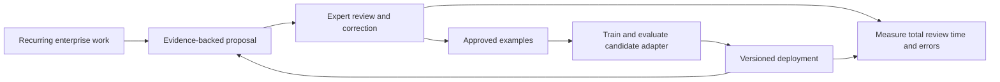

# Enterprise business value: Box workflows that learn from expert corrections

Research date: October 16, 2026, America/Los_Angeles. The user clarified that the focus is **enterprise business use cases across functions; Harvey is one example, not a legal-market constraint**, and has no specific customer or document access yet. This brief combines public-source research by Codex and a tool-enabled Claude Opus 5.5 legal-market review. It is opportunity research, not customer validation, legal advice, a pricing survey or evidence of trained-model performance.

## Current scope: enterprise use cases across functions

The original comparison overweighted legal and document approval. The relevant search space is broader: enterprise work where repeated expert corrections could improve a model's future actions or outputs. Box can supply manuals, work products and institutional knowledge, while other systems supply tickets, transactions and execution APIs. Box skills alone do not provide those other integrations.

The buyer roles, proposed learning targets and relative attractiveness below are hypotheses. Existing vendor results establish relevant business workloads; they do not demonstrate an incremental benefit from our proposed weight updates.

| Enterprise use case | Buyer and costly job | What actual weight learning could target | Business KPI | Box's proposed role |
| --- | --- | --- | --- | --- |
| **IT support and incident-resolution apprentice** | CIO / IT service management: repeated investigations and escalations consume analyst time and prolong employee disruption. | Select the next diagnostic step and assemble a resolution plan from validated incident outcomes and expert corrections. | Analyst effort, time to resolution, recurrence/reopen rate, successful completion. | Current runbooks, architecture documents and postmortems; a ticketing/execution connector is separate. |
| **Enterprise technical customer-support apprentice** | VP Support / Customer Success: experienced engineers repeatedly solve similar product problems. | Diagnostic question selection, evidence synthesis and escalation decisions from verified resolved cases. | Resolution time, senior-engineer touches, reopen rate, customer satisfaction. | Manuals, support knowledge and troubleshooting guides; case history comes from the support system. |
| **Professional-services scoping apprentice** | Head of Delivery / Professional Services: solution architects repeatedly turn customer requirements into scoped work and estimates. | Map requirements to work packages, recognize exclusions and revise scope from expert-approved proposals plus actual delivery outcomes. | Architect hours, proposal turnaround, scope rework, estimate error and project margin. | Prior SOWs, delivery templates, project retrospectives and output generation; actuals need the delivery system. |
| **Manufacturing quality and field-service apprentice** | Quality or Service Operations: recurring defects and faults consume scarce engineering expertise. | Link symptoms and inspection findings to validated investigation paths and corrective-action proposals. | Engineering review time, repeat defects, rework and downtime. | SOPs, manuals, inspection reports and approved corrective actions; MES/CMMS data is a separate integration. |
| **Sales-engineering / RFP apprentice** | Sales Engineering / Revenue Operations: specialists repeatedly explain capabilities and correct proposal answers. | Transform current evidence into accepted responses and recognize when a specialist must review. | SME touches, approved-response time, unsupported claims. | Product documentation, approved proposals and source evidence. |
| **Finance shared-services exception apprentice** | Finance Operations: staff reconcile ambiguous documents and resolve recurring processing exceptions. | Context-sensitive field selection and exception-resolution proposals learned from approved corrections. | Cost and correction time per transaction, rework and straight-through processing. | Invoices, orders and supporting files; ERP remains the system of record. |
| **HR employee-service apprentice** | HR Operations: coordinators handle recurring employee cases and handoffs. | Case interpretation, next-step planning and appropriate routing; current policy remains explicit. | Case effort, resolution time, handoffs and employee satisfaction. | Policies, forms and approved procedures; HRIS data and actions require another integration. |
| **R&D research-reuse apprentice** | R&D leadership: scientists struggle to reuse past experiments and interpret legacy reports. | Domain-specific relevance and evidence synthesis from expert-labeled comparisons; retrieving facts alone does not justify training. | Search effort, reuse of prior results and avoided duplicate work. | Lab notebooks, test reports and experimental archives. |
| **Marketing and content-production apprentice** | Brand / Content Operations: reviewers repeatedly correct tone, localization and asset adaptation. | Approved editing transformations and brand judgments. | Review rounds, editor effort, time to approved asset. | Approved assets, briefs, revision history and destinations. |
| **Legal review apprentice — Harvey reference** | GC / Legal Operations: recurring contract review consumes counsel capacity. | Contextual first-review dispositions and drafting transformations. | Reviewer time, turnaround and missed issues. | Agreements, approved standards and cited review evidence. |

## Broad business evidence and competitive baselines

**IT and employee service.** Moveworks sells enterprise self-service across IT, HR and other functions. It publishes an Amadeus result of 44% fewer support calls and over 16,000 employee hours returned monthly. These are vendor-published customer results, not a prediction for our product or proof of per-customer weight learning. The business category is established and competitive. [Moveworks enterprise self-service](https://www.moveworks.com/us/en/solutions/self-service)

**Customer support and professional services.** Box reports that its own support knowledge workflow answered over half of questions through self-service and saved more than 1,000 hours to date. It separately reports a 35% reduction in SOW creation time and 2,000 hours returned using extraction and document generation. These are Box's internal reported results, with no independently verified measurement supplied. They demonstrate relevant workloads and strong non-training baselines. [Box's support, sales and services workflows](https://blog.box.com/how-box-uses-box-ai-transform-customer-support-sales-and-services)

**R&D.** Box describes Owens Corning digitizing an 85-year archive of lab notebooks and test results for searchable research reuse. The article does not supply a controlled ROI measurement. It supports the importance of institutional knowledge, while also showing why retrieval should be the starting baseline. [Owens Corning research reuse](https://blog.box.com/owens-corning-turned-85-years-lab-notebooks-ai-powered-knowledge-base)

**Manufacturing.** Box's manufacturing offering names quality records, change orders, supplier information, SOPs, quality triage and maintenance assistance. This is a vendor capability description rather than a measured learning result. It gives a content foundation for investigating a specialist quality or service workflow. [Box manufacturing](https://www.box.com/en-gb/industries/manufacturing)

## Current cross-functional shortlist

For further enterprise discovery, prioritize **technical customer support**, **professional-services scoping**, and **manufacturing quality / field service**. These are judgment-based candidates, selected for repeated expert decisions and potential business impact; no customer access or market advantage has been established. IT support is another measurable, feasible candidate, with substantial incumbent competition. Legal remains one option in the landscape.

For any candidate, separate the current facts retrieved from Box from the behavior learned in an adapter. The learning hypothesis is that approved corrections improve the next unseen case, beyond what a strong instruction/retrieval baseline achieves. A historical case closed as "resolved" is not necessarily a trustworthy training example; verified outcomes and captured expert reasoning matter.

The most useful next business question is: **which expensive recurring decision has reliable outcome data and a budget owner who still has a problem after using existing tools?** That question should decide the vertical before the technology or the Harvey analogy does.

The earlier focused analysis below remains supporting research for selected document workflows. It is not the overall market boundary or the current cross-functional shortlist.

## Supporting comparison: document-review workflows

The enterprise proposition is **reduce repeated expert review and cross-team rework in a recurring document workflow**. Actual weight learning is a possible implementation that must earn its place against explicit playbooks, retrieval and existing enterprise products.

Harvey is a useful reference because it packages legal expertise into document review, drafting, research and operational workflows. However, Harvey already connects to Box, and it has announced contract intelligence that adapts playbooks from past agreements. Box integration and “learning your organization” are therefore insufficient differentiation by themselves. [Harvey's Box integration, March 18, 2026](https://www.harvey.ai/blog/introducing-harvey-box-integration), [Contract Intelligence announcement, May 21, 2026](https://www.harvey.ai/blog/introducing-contract-intelligence)

The strongest enterprise opportunities to compare are:

1. **Third-party risk and supplier-onboarding evidence review** — turn a fragmented document packet into an evidence-backed, reviewer-confirmed readiness decision.
2. **Commercial contract first-pass review** — apply a legal team's preferred positions and escalate the departures that require counsel.
3. **Enterprise RFP and security-questionnaire response** — reduce subject-matter-expert review and response rework while grounding answers in current approved sources.
4. **Shared-services document exceptions** — resolve recurring semantic exceptions in invoice, purchase-order or operational-document processing.

This is a shortlist for discovery, not a claim that any segment has unmet demand for our proposed product. All have substantial incumbent competition.

## What the evidence establishes

| Evidence | What it supports | What it does not establish |
| --- | --- | --- |
| Harvey's Carvana case study reports 7–10 hours reclaimed per lawyer per week and an 80% reduction in drafting/review time for its initial playbook use. | Expert review capacity and turnaround have an enterprise buyer. | Independently measured causal effects, a result we can reproduce, or a need for per-customer weight training. |
| Box reports NOVO processing 1,300 certificates of insurance in 30 days, with 98% accuracy. | Repeated supplier/project document handling is a real operating workload. | Equivalent performance on new customers or that the remaining errors require LoRA. |
| Responsive reports 2,320 staff hours saved in one quarter at Tenable, and proposal/questionnaire drafting reduced from ten days to two–three days. | Expert response work is a meaningful enterprise capacity bottleneck. | Causal improvement in win rate or a whitespace market. |
| Rossum reports Fugro reducing invoice handling from two minutes to 35 seconds, across a workflow processing about 300,000 invoices yearly. | Document operations have measurable unit economics at scale. | That a new generic invoice extractor would be differentiated. |

These are vendor-published customer results or estimates, not independent trials. Source methods and accuracy definitions are not sufficiently detailed to transplant them into a forecast. [Carvana/Harvey](https://www.harvey.ai/customers/carvana), [NOVO/Box](https://blog.box.com/novo-construction-built-secure-ai-workflow-extract-and-validate-coi-data-98-accuracy), [Tenable/Responsive](https://www.responsive.io/customer-stories/tenable), [Fugro/Rossum](https://rossum.ai/customer-stories/fugro/)

There is also primary survey evidence of unfinished automation. APQC's summary of its August 2025 procure-to-pay research says 63% of respondents had implemented AP automation, while only 8% reported nearly or fully automated supplier-invoice processing. Its public summary does not give enough sample detail to infer a market-wide percentage. CLOC's March 2026 industry summary describes increased demand in complex contracting alongside tighter budget-growth expectations. These are demand/context signals, not proof of willingness to buy our product. [APQC](https://www.apqc.org/How-Can-a-Finance-Organization-Determine-Whether-Its-FTE-Levels-Are-Appropriately-Geared), [CLOC](https://cloc.org/blog/soti/clocs-2026-state-of-the-industry-report-benchmarking-data-is-the-compass-for-legal-operations-to-navigate-change/)

## Enterprise opportunities and buyers

Buyer assignments, proposed differentiation and learning value below are hypotheses from the workflow analysis, not customer-interview findings.

| Use case | Economic buyer / daily user | Recurring business problem | Primary outcome to measure | Possible learned behavior | Main competitive challenge |
| --- | --- | --- | --- | --- | --- |
| Third-party risk and supplier onboarding | Head of Procurement, Third-Party Risk or enterprise Operations / reviewers and coordinators | Documents arrive across formats and versions; reviewers repeatedly reconcile evidence, chase gaps and hand cases between teams. | Reviewer minutes per packet, time-to-ready, clarification rounds, incorrect ready decisions. | Match varied evidence to requirements, recognize recurring near misses, propose the right follow-up or specialist route. | Box-native workflows already cover substantial parts; explicit rules and retrieval may suffice. |
| Commercial contract review | General Counsel or Legal Operations / commercial counsel and contract managers | Routine agreements consume counsel capacity; deviations and fallback decisions recur. | Total reviewer time including verification, turnaround, outside-counsel usage, missed material issues. | First-review disposition and minimal drafting transformations for one agreement family and context. | Harvey already offers playbooks and contract intelligence; competing on general legal capability is implausible for a POC. |
| RFP and security-questionnaire responses | Revenue Operations, Sales Engineering or proposal leadership / proposal writers and security SMEs | Teams answer repeated but differently worded questions, chase approved evidence and revise drafts. | SME touches, review minutes per answer, time to approved response, unsupported claims. | Transform current evidence into the team's accepted answer form; recognize questions that require escalation. | Responsive and Loopio already provide approved-content libraries and AI drafting. |
| Shared-services document exceptions | Shared Services leader or Finance Operations / AP and operations analysts | Automation handles routine fields but semantic exceptions, reconciliation and supplier communications still need staff. | Human touches and correction minutes per document, straight-through rate, rework and processing errors. | Context-dependent field selection, exception classification and evidence-backed resolution proposals. | Rossum already markets learning from corrections and end-to-end workflows; ERP integration is substantial work. |

The competition observations follow the vendors' public offerings, not controlled comparisons. [Box's internal workflows](https://blog.box.com/how-were-going-ai-first-workflow-inside-box), [Harvey playbook builder](https://www.harvey.ai/blog/playbook-builder-in-harvey), [Responsive response workflow](https://www.responsive.io/customer-stories/tenable), [Loopio customer workflows](https://loopio.com/customers/), [Rossum's stated feedback adaptation](https://rossum.ai/solutions/wholesale-distribution-software/)

## The Harvey-like opportunity

**Proposed product:** a commercial-contract review apprentice for a Box-centric enterprise legal team, initially one agreement family.

The useful job is: identify deviations from the current approved standard, suggest a disposition or named fallback, cite the relevant text, and assemble counsel's review queue. Its potential business value is reduced first-pass labor and more consistent escalation. It does not replace counsel's legal judgment.

Training labels should capture the reviewer's first-pass disposition with relevant deal context. Final signed language is not automatically a preference label: bargaining power, transaction context and negotiated compromises can explain it. The initial pilot would compare a strong playbook prompt, retrieval of approved prior decisions and an adapter using the same source information. The business metric is measured reviewer time with retained issue detection, rather than text similarity to a redline.

Harvey's August 2026 Playbook Builder already turns standards and prior documents into cited preferred positions, fallbacks and escalation rules. That makes simple “we capture your team's knowledge” positioning weak. A new entrant would need a specific segment, process, deployment constraint or demonstrable quality/cost advantage that existing playbooks do not satisfy. [Harvey Playbook Builder](https://www.harvey.ai/blog/playbook-builder-in-harvey)

The reviewed pages establish customer-level playbooks, context and workflow adaptation. They do **not** establish that Harvey runs automatic per-customer weight updates; “continuously improves” is not proof of gradient training. Nor do we have evidence that our LoRA would beat Harvey.

For an in-house department, time savings can release internal capacity or reduce outside work. For an hourly-billing firm, fewer hours do not automatically become higher profit: utilization, replacement work, client expectations and fee arrangements determine the economics. Fixed-fee work has a different incentive. This is economic reasoning, not a universal claim about law-firm pricing.

## The strongest alternative: enterprise onboarding exception desk

**Proposed product:** a review desk for one supplier or project packet type, where the expensive work is reconciling evidence and resolving exceptions across documents.

The output is an evidence table: requirement, supporting passage, missing or conflicting information, suggested next action and responsible reviewer. A human confirms readiness. Current policy and numeric requirements stay explicit and versioned; learning targets recurring interpretations and handling patterns, not authorization or policy enforcement.

Box itself describes vendor assessment automation involving document-heavy reviews. Its legal team also reports replacing a third-party metadata/dashboarding CLM costing over $300,000 annually using Box Extract and Box Apps. This is evidence of budget and platform substitution, but also a warning that Box can absorb generic workflow features. The figure is Box's own reported former contract cost, not the price or savings potential of our proposed product. [Box internal workflow account](https://blog.box.com/how-were-going-ai-first-workflow-inside-box)

The proposed gap must therefore be narrower than extraction or folder routing: for example, a recurring, organization-specific evidence ambiguity that still creates manual back-and-forth after native extraction. Customer discovery must confirm that gap exists.

For the hackathon, an operator could correct a misinterpreted packet, train an adapter and show the improved interpretation on unseen packets. With no actual customer data, synthetic examples demonstrate the mechanism only. They do not establish enterprise accuracy or willingness to pay.

## RFP response as a revenue-facing option

**Proposed product:** an evidence-grounded response assistant for one recurring enterprise questionnaire family, which learns from reviewers' accepted edits.

Keep current product capabilities, security controls and factual answers in approved, permission-aware source material. Let the adapter learn recurring response transformations, question interpretation and escalation behavior. Obsolete claims should not become an opaque learned source of truth.

The commercial hypothesis is fewer SME interruptions and faster approved responses. Responsive's Tenable example demonstrates established purchasing and substantial incumbent capability. Do not use a reported win rate as proof that faster drafting causes more wins. The proposed product must demonstrate something an existing content library, few-shot examples and approved-answer retrieval do not already provide. [Tenable case study](https://www.responsive.io/customer-stories/tenable)

## What learning contributes to the business



This is a proposed operating model. Enterprise value comes only if the feedback loop reduces subsequent work without unacceptable regressions.

| Technical capability | Business hypothesis | Required proof |
| --- | --- | --- |
| LoRA from approved corrections | The same mistake needs correcting less often. | Unseen-case improvement and lower total human effort versus strong baselines. |
| Distilled Box skill procedures | Repeated jobs cost less or fail less often. | Cost per successfully completed job and semantic outcomes with live schemas and controls. |
| Persistent factual insertion | A few stable facts are recalled conveniently. | Advantage over current, cited retrieval; TensorFold's narrow experiments do not establish enterprise knowledge management. |

Compiled Skills is best treated as an implementation capability inside a valuable workflow until a buyer's cost or reliability problem justifies it as a separate product. Per-team adapters also do not automatically enforce source-document permissions; enterprise training boundaries and deployment access would need explicit design.

## Unit economics without invented market prices

Use measured processing and review effort:

```text
Gross capacity value per month = monthly completed cases
                              × net minutes saved per case / 60
                              × loaded labor cost per hour

Net economic value = gross capacity value
                   + separately measured avoided rework or external expense
                   - extra labeling, evaluation and model-maintenance effort
                   - software, compute and amortized integration costs
```

**Illustrative assumptions only:** 10,000 cases per month × 6 minutes saved × $75/hour ÷ 60 = **$75,000/month of gross capacity value**. No customer volume, time saving or cost rate has been validated. Time saved already includes checking the AI output. Capacity is not automatically cash savings, and deal acceleration should not be monetized without evidence. Vendor-reported ROI is not a substitute for a customer's baseline. Avoid counting the same saved minutes twice under labor and avoided rework.

## Earlier focused shortlist and customer validation

Within the earlier document-review subset, the shortlist was **commercial contract review** and **supplier/third-party evidence review**, with RFP responses as a third path. That subset does not constrain the broader enterprise exploration above. With no users or sample data, there is not enough evidence to declare a commercial winner.

Choose one buyer, one recurrent decision and one packet or agreement family for the POC. Then validate:

1. What happened in the last actual case? Obtain the sequence, handoffs, measured touch time and waiting time.
2. Who owns the cost and budget, and which existing tool is already funded to solve it?
3. Which errors recur despite written instructions? Are approved corrections recorded with enough context to train on?
4. Would the organization allow the proposed training and deployment boundary? Who owns the resulting adapter and its updates?
5. Does a paid pilot have a measurable outcome and a sponsor willing to own adoption?

The pilot should compare workflow automation with strong prompts/retrieval against the same workflow plus adaptation. Hold out counterparties, vendors or template families, retain a regression set and count all review and maintenance effort. Choose the required quality and economic thresholds with the buyer before testing. If the strong baseline ties the adapter, report that result: the workflow may still be valuable, while weight learning has not earned an incremental business claim.

## Research record and limits

Codex reviewed the primary sources linked above. Claude Opus 5.5 independently researched legal vendors, customer reports, surveys and the Box contract skill with full built-in tools available. The primary findings selected here were checked by Codex. Figures from inaccessible ACC/OpenAI pages and secondary coverage in the worker's broader notes were excluded from the main evidence claims.

- Claude main model: `claude-opus-5-5`; internal web processing also reported `claude-haiku-5-5`.
- Session: `3be372a1-2887-4469-acf5-64915f452af2`; 41 turns, 322.145 seconds reported duration.
- Tools observed: 22 WebFetch, 12 WebSearch, 4 Bash requests, 1 ToolSearch and 1 Write. One Bash cleanup request was denied and did not run.
- CLI list-price usage estimate: $0.9844562 via Claude.ai Max authentication, not an asserted additional invoice charge.
- No customer interviews, customer outreach, private document access, authenticated Box/Harvey tests, training or benchmarks were performed. No product repositories or Loom tickets changed. No source checkout was inspected at a newly pinned Git revision in this business research.
- The worker's cleanup guard initially rejected removal of its working directory. The user subsequently approved cleanup of `/private/tmp/box-learning-business-opus55-9ntoojwx`. Codex verified the exact task-owned file inventory, durable report, absence of symlinks/checkouts and absence of open process handles, then removed that directory and verified it no longer existed. This report remains retained durably.
