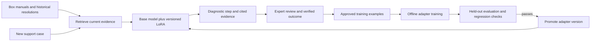

# Enterprise learning opportunities: business value, training evidence and recent funding

Research date: October 16, 2026. Funding window: July 16–October 16, 2026 inclusive, using original announcement dates. This is a cross-functional enterprise comparison. Rankings are research judgments, not measured market shares, customer validation or returns.

## Decision

Prioritize **technical-support diagnostic sequencing** when the goal is a Box-centered language-model learning POC. It combines a repeated, costly enterprise job with feedback that can describe a correct sequence of investigation and escalation. Start with one product and a narrow failure family. The practical outcome is lower cost per durable resolution, with fewer repeat contacts and less specialist review.

Prioritize **finance exception interpretation** when the goal is the clearest business-value conversation: recover cash, resolve disputed invoices and reduce specialist handling. Its incremental benefit from language-model weight updates is less established in the public evidence reviewed. An excellent integration and rules-based workflow may already capture much of the value.

**IT incident diagnosis** has unusually concrete task-training evidence, but live telemetry, dependency graphs and historical incident access make it harder to demonstrate convincingly with documents alone. **Manufacturing quality** also has a clear customer-training mechanism in computer vision; that does not automatically transfer to an LLM that writes inspection reports.

The founder has no established customer access, labeled proprietary documents, hackathon duration or actual training hardware. Those unknowns can change the choice. A synthetic-data demonstration proves a mechanism only; it does not establish enterprise value.

## Opus's ranking and the combined interpretation

The completed [Opus 5.5 report](enterprise-use-case-ranking-opus55-2026-10-16.md) ranks the opportunities below. Its 1–5 ratings are ordinal judgments, not calculated ROI, probabilities or measured improvements. They were made independently of the funding search. The combined recommendation above also considers Box fit and realistic data access.

| Opus shortlist order | Enterprise area | Business value / 5 | Incremental learning value / 5 | Main qualification |
|---|---|---|---|---|
| 1 | IT incident triage and resolution | 4 | 4 | Strongest direct task-training evidence; need historical incidents and live operational context |
| 2 | Maintenance / field-service corrective action | 4 | 4 | Public-log offline candidate; license and representative labels unverified; report-similarity results do not establish first-time fixes |
| 3 | Technical customer support | 5 | 3 | Best business-outcome evidence in the review; pooled vendor training is different from a customer-specific continual adapter |
| 4 | Finance exceptions | 4 | 3 | Strong economics and recent financing signals; ordinary ML, rules and integrations are formidable baselines |
| 5 | R&D, predictive subset | 3 | 3; archive search 1 | Learning prediction from experimental outcomes is a different product from searching notebooks |
| 6 | Professional-services scoping | 4 | 2 | Useful document workflow; sparse, delayed and confounded delivery labels |
| 7 | RFP / security questionnaires | 4 | 1 | Current approved evidence is central; behavior learning remains possible but unproven here |
| 8 | HR employee service | 3 | 1 | Valuable automation; current policy and cross-system execution may deliver most of the gain |

These ratings should not be read as proof that categories 1–4 require an LLM or that categories 6–8 cannot benefit from one. Within the public evidence reviewed, none establishes a controlled business-metric advantage for continual per-customer weight updates over strong instructions, retrieval and a conventional classifier. The strongest support is for narrower, periodically trained tasks.

## What public evidence establishes

| Area | Primary evidence | Supported conclusion | Remaining boundary |
|---|---|---|---|
| Technical customer support | Intercom describes a custom-trained support model replacing its previous answering model and reports one customer's resolution rate increasing from 68% to 75%. Its current model-suite page documents post-training, a fine-tuned 14B issue summarizer and specialized routing models. [Launch](https://www.intercom.com/blog/announcing-fin-apex-the-age-of-vertical-models-is-here), [model suite](https://fin.ai/cx-models) | Domain-trained models have a real production use in support | Vendor-reported results do not isolate small customer-specific LoRA, online learning or a controlled training-only causal effect. Apex 2.0 changes both base model and training data |
| IT incident diagnosis | Meta describes continued pretraining and SFT of Llama 2 7B on internal material and roughly 5,000 investigation examples; historical backtesting put the culprit among five suggestions in 42% of investigations at their start. [Engineering account](https://engineering.fb.com/2024/06/24/data-infrastructure/leveraging-ai-for-efficient-incident-response/) | Concrete task-specific training plus retrieval/ranking exists for enterprise incidents | This is a 2024 system and a top-five backtest metric, not current-model superiority or a measured reduction in outage duration; no modern strong-prompt ablation is supplied |
| Support escalation | ByteDance's TickIt uses feedback labels, offline LoRA training and a later online model update. Its F1 comparison is 0.862 for SFT versus 0.849 for prompted retrieval of examples, with 160 later test tickets. [Paper](https://arxiv.org/html/2504.08475v1) | Actual feedback-to-weight-update mechanism and a task comparison exist | Small incremental gain, selective feedback and a single-company dataset; reported system-wide MTTR improvement does not isolate the fine-tuning contribution |
| Telecom troubleshooting | TeleDoCTR's retrieved-demonstration variant scored 3.33 in LLM-judged fault-analysis accuracy versus 2.56 for its fine-tuned report/ranking variant, despite the latter's better text-similarity metrics. [Paper](https://arxiv.org/html/2601.00691v1) | A real counterexample to assuming fine-tuning wins | Judge scores are imperfect; evaluate correct root causes separately from plausible report prose |
| Tool-using service agents | Salesforce's APIGen-MT trains on verified multi-turn trajectories. Its reported xLAM-2-70B overall τ-bench score is 56.2%, versus 38.2% for the base Llama 3.1 70B. Its table also reports 69.8% for Claude 3.7 with an optimized prompt. [Research project](https://apigen-mt.github.io/) | Training can improve a fixed base model's tool-use behavior | A 2025 benchmark does not prove superiority to the best prompted model, a production outcome, or customer-specific adaptation |
| Manufacturing quality | Rapta instructs customers to capture and annotate local parts/defects, then train an object detector before inspection. [Training documentation](https://rapta.ai/knowledge-base/part-verification-and-part-library/) | A concrete customer-facing model-training loop exists | Computer vision training, not evidence that LLM LoRA improves diagnosis or report reasoning; no controlled outcome ablation in this source |
| Professional-services documents | Box reports 35% less SOW creation time and 2,000 hours saved through extraction, document generation and human review. [Box account](https://blog.box.com/how-box-uses-box-ai-transform-customer-support-sales-and-services) | A useful, document-native enterprise workflow and a strong existing baseline | The account does not demonstrate incremental gains from model-weight updates |
| Harvey, one comparator | Harvey reports RL post-training of an orchestrator within a fixed RLM harness, improving rubric-criteria pass rate from 29.9% to 63.0% on 50 held-out synthetic diligence rooms. [Technical account](https://www.harvey.ai/blog/post-training-rlm-agents-for-m-and-a-diligence) | Task-specific agent behavior is learnable under a matched evaluation | Rubric pass rate is not complete-task success or deployed ROI; large-model RL infrastructure does not establish a small local adapter's feasibility |

The transferable learning target is **how to interpret evidence, investigate, choose actions and escalate**. Current product facts, policies, invoice balances, permissions and infrastructure state still belong in retrieved evidence and application controls.

## Recent financing: selected primary-confirmed examples

Funding is a signal of capital activity and competition. The sources' customer and outcome claims are self-reported. Neither the investment nor the claimed workflow outcome establishes that parameter updates caused value.

| Announced | Company | Enterprise job | New financing announced | Primary source |
|---|---|---|---|---|
| July 28 | COR | Services project economics and profitability | $30M investment; series unstated | [FTV](https://ftvcapital.com/2026/cor-secures-30-million-investment-from-ftv-capital/) |
| July 29 | Freehand | Supply-chain spend and invoice exceptions | $75M funding; series unstated | [Company release](https://www.globenewswire.com/news-release/2026/07/29/3335250/0/en/freehand-raises-75m-to-scale-ai-teams-managing-supply-chain-spend-for-fortune-500-companies.html) |
| August 4 | HappyRobot | Operational coordination and customer care | $150M Series C | [Lead investor](https://www.prysmcapital.com/news/why-we-invested-in-happyrobot-a-bot-above-the-rest) |
| September 16 | Rapta | Manufacturing quality and traceability | $8M round; series unstated | [Company](https://rapta.ai/2026/09/rapta-closes-8-million-funding-round-to-scale-ai-powered-quality-assurance-for-defense-and-precision-manufacturing/) |
| September 16 | Noetive | Industrial operations | $41M seed | [Company](https://noetive.ai/news/noetive-emerges-from-stealth-with-41-million-seed) |
| September 23 | Ema | HR, IT and finance service execution | $77M Series B | [Company release](https://www.globenewswire.com/de/news-release/2026/09/23/3367506/0/en/ema-raises-77m-series-b-to-put-ai-employees-to-work-across-the-enterprise.html) |
| October 7 | Stuut | Order-to-cash and dispute resolution | $52.5M Series B | [CEO](https://www.stuut.ai/blog/why-we-raised-series-b) |
| October 14 | Duvo | Cross-system enterprise operations | $32M Series A | [Company release](https://www.prnewswire.com/news-releases/duvo-raises-32-million-series-a-to-become-the-one-platform-enterprises-run-their-operations-on-302908575.html) |

The [full funding report](enterprise-startup-funding-jul16-oct16-2026.md) includes HR specialists, one Harvey comparator, leads/participants, capital-structure caveats, excluded old announcements and coverage gaps. empirik's over-$21M launch disclosure is separated because the primary wording does not distinguish a new round from aggregate funding. Omilia's announced transaction is separate because completion was conditional. No directly comparable in-window RFP or R&D-reuse round was confirmed in that search; this is a coverage limit, not evidence of no investment.

Freehand describes a context graph and HappyRobot's investor describes an operational context layer. These are substantive alternatives to weight learning. A product that accumulates useful context can improve while leaving language-model parameters fixed.

## A testable Box POC

Box Agent Skills provide task instructions for using Box; Box access is separately authorized. The repository supplies no model-training pipeline. [Repository](https://github.com/box/skills)

This is a proposed architecture, not an implemented or validated training system. Use one narrowly supported model/training stack, chosen after hardware is confirmed. LoRA/QLoRA can target behavioral learning. TensorFold Living Weights currently documents factual insertion into added shared-expert neurons for one supported Nemotron checkpoint; its documentation does not establish learning diagnostic policies from resolution traces. [Living Weights](https://github.com/ashhart/TensorFold/blob/main/docs/living-weights.md)

Before training, reserve whole incident families, customer accounts or product versions for evaluation. Keep near-duplicate tickets and all revisions of a case in the same split. Compare:

1. Strong instructions, current retrieval and selected successful examples.
2. The same model and evidence, plus the trained adapter.
3. A conventional classifier or explicit decision tree where it can express the task.

Measure correct diagnostic next steps, durable resolution, reviewer minutes, unnecessary escalation, unsupported instructions, reopening and cost per correct case. A saved artifact, adapter-off/on comparison and successful reload establish persistence; unseen-case performance establishes generalization. Mere acceptance clicks or lower deflection do not establish successful support.

Stop the learning track if strong retrieval and examples match it, its errors increase, or the apparent gain disappears after duplicates and future information are removed. The workflow can still be commercially useful; that result would change the product's learning claim.

## Research boundary

No training, model installation, authenticated Box operation, customer interview or production trial was performed. No Loom tickets were created or modified. Canonical repository state was checked and left intact: LoomCLI `v5` at `28e657bdcd4c39ef55ea3f6bbaaaf35df4c1ce2f`, tracking `origin/v5`, with the pre-existing untracked `.DS_Store` preserved; FleetDB `main` at `40e8431ddd369cdd125d91cbb7096ec7326b12c1`, tracking `origin/main`, clean. Canonical freshness/build was not claimed because of the preserved untracked path. Current web primary sources support the market findings.

Opus ran with all default built-in tools and automatic permission checks, using 25 searches and 36 page fetches. Main model: `claude-opus-5-5`; internal web-tool usage also recorded `claude-haiku-5-5`. No main-model fallback, permission denial or safety stop occurred. The complete tool trace and metadata are in [the evidence directory](enterprise-opus55-ranking-evidence-2026-10-16/run-metadata.json). The separate funding agent completed its report; the supervisor independently checked original announcements for COR, Freehand, HappyRobot, Rapta, Noetive, Ema, Stuut and Duvo, as well as key technical sources. Snippet-only claims in the Opus report were not adopted as verified findings here.

Scratch cleanup: `/private/tmp/enterprise-opus55-ranking-bjppqshx` was removed after run completion, ownership/inventory checks, no open handles or Git worktrees, and hash-verified preservation of the report and tool trace. Its absence was verified.
