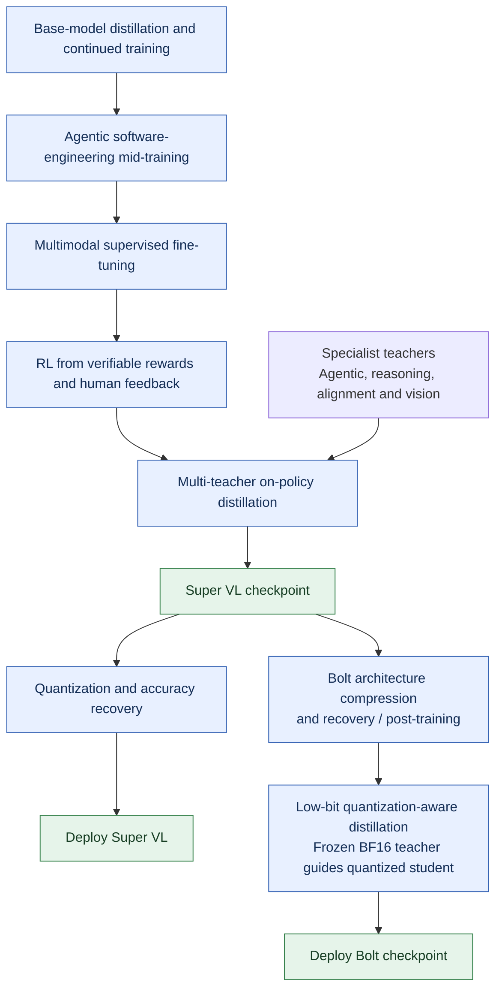
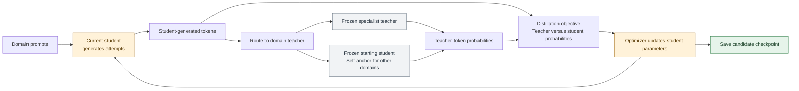
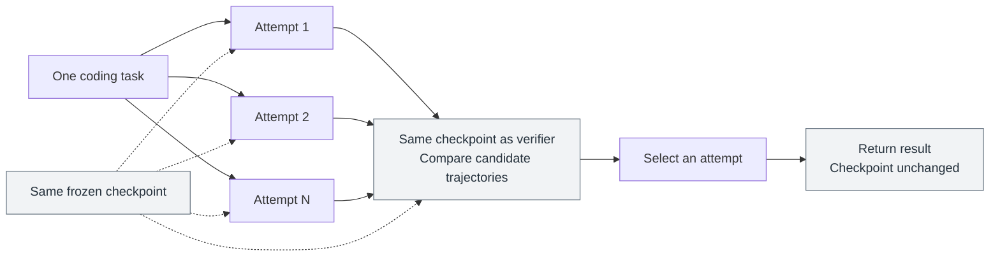
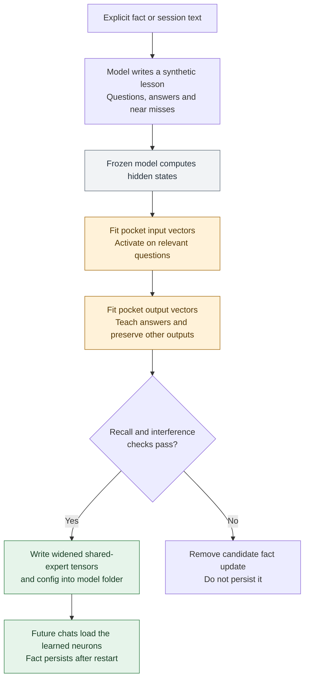
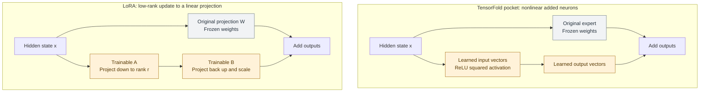
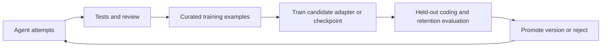

# TensorFold, LoRA and the October 2026 Nemotron launch

Research date: October 16, 2026, America/Los_Angeles. Primary-source review only; no model downloads, training, inference, installations, or paid calls.

## Finding

The October 15 release is **Nemotron 3.5 Super VL 120B-A12B** and **Nemotron 3.5 Bolt 74B-A9B 24GB**. These are open models accompanied by customization and inference infrastructure. I found no documented mechanism in this launch that automatically edits and saves personal model weights during ordinary conversations, as TensorFold Living Weights attempts to do.

The distinction follows the documented pipelines and is an inference from their scope, rather than proof that no related experimental component exists anywhere in NVIDIA's ecosystem. The user explicitly clarified this launch; unrelated research named “self-learning” is not its identity.

The public announcement is dated October 15. The underlying Super/Lightning research page is dated October 14. Bolt E4B 4GB is announced for October 23 and is not an already-released October 16 option. [NVIDIA launch announcement](https://blogs.nvidia.com/blog/nemotron-3-5-super-vl/)

## What the launch actually offers

The technical launch blog explicitly describes developer customization through **SFT, LoRA, and reinforcement learning** using NeMo. Its application examples are organizations post-training on their own domain data and workflows. These claims concern specialized checkpoints and deployments, rather than a running model automatically remembering every user correction. The blog also describes synthetic data, environment-based evaluation, and deployment recipes. [October 15 technical launch blog](https://developer.nvidia.com/blog/nvidia-nemotron-3-5-super-vl-powers-specialized-agents-with-multimodal-reasoning/)

## Super VL's training architecture

The model has a hybrid Mamba–Transformer MoE backbone and a vision encoder. Its production of a useful agent involves several separate stages:

1. Distillation and continued training build the base model's capabilities.
2. Multimodal SFT teaches demonstrations of the required outputs and trajectories.
3. RLVR/RLHF optimize behavior against environment or preference feedback.
4. Separate specialist teachers push different capabilities further.
5. Multi-teacher on-policy distillation consolidates them into a student checkpoint.

These stages describe how NVIDIA produces the model, rather than a mandatory pipeline every user must rerun. [Super and Lightning research release, October 14](https://research.nvidia.com/labs/nemotron/Nemotron-3.5-Super-and-Lightning/)



**Reading the diagram:** blue boxes are preparation/training stages; green boxes are checkpoints or deployments. This is a simplified lifecycle, with intermediate recovery stages omitted. The arrows do not represent learning from a live user's chat.

### What MOPD changes

The student samples its own responses. A teacher selected for the prompt's domain scores each generated token. The optimization uses the difference between teacher and pre-update student log probabilities as a dense token-level advantage, minimizing reverse KL on student rollouts. Domains without a specialist use a frozen copy of the starting student as a self-anchor, limiting departures from previous behavior. Rollout generation, teacher scoring, and student optimization are distinct pipeline stages.

“On-policy” means training on trajectories from the current/recent student policy; it does not mean automatically learning from a user's live production chat. The documentation cautions that teacher checkpoints are unpublished and some required environments are not public. The full reference recipe is therefore not currently reproducible entirely from released components. [MOPD method and public-component limits](https://docs.nvidia.com/nemotron/latest/nemotron/super35/rl/mopd.html)



**Where learning happens:** the optimizer changes the student; the teachers stay frozen. The diagram summarizes the common mechanism and omits the two phases' mixture and routing differences.

The broader RL reference uses GB200 clusters: for example, 128 nodes with four GPUs per node for each MOPD phase, including generation and teacher fleets. The docs explicitly say their ported RL configurations have not been run end to end on GPUs from that repository. These are published reference configurations, not lower bounds for all possible adaptation approaches. [RL stages, infrastructure, and reproduction status](https://docs.nvidia.com/nemotron/latest/nemotron/super35/rl/index.html)

### What self-verification does not change

Section 3.11 of the technical report describes several independent agent attempts and a selection procedure performed by the same checkpoint. It explicitly says this “requires neither additional parameter updates nor a separately trained verifier.” This is **test-time selection**, not persistent weight learning. The candidate trajectories improve the chance of selecting a successful answer for that task. A later request does not automatically inherit a trained capability from that selection.

The same distinction applies to MTP and speculative drafters: their inference role is proposing and verifying tokens faster. Their training happens in separate preparation stages. [Super/Lightning technical report, §3.11, PDF pages 26–28](https://research.nvidia.com/labs/nemotron/files/NVIDIA-Nemotron-3.5-Super-and-Lightning-Technical-Report.pdf)



**Where compute is spent:** generating and judging attempts. There is no optimizer or checkpoint-save step in this inference procedure.

## A concrete Super VL LoRA example

NeMo AutoModel documents receipt-field extraction on CORD-v2. Its LoRA recipe freezes the base and trains rank-64 adapters in selected Mamba, attention, latent-MoE, and shared-expert projections. It excludes the vision components and output head. The recipe reports 177 million trainable parameters, 0.15% of the model, and saves adapter-only safetensors plus configuration. An inference example merges those deltas into the base weights.

The published configuration uses **eight H100s, about 39 GiB per GPU**. Full SFT uses **32 H100s, about 65 GiB per GPU**. This demonstrates the training-state saving from freezing the base; it does not establish that a 256 GB Mac can execute this CUDA/Transformer Engine/DeepEP recipe. Nor does it prove such a Mac cannot train a different supported quantized adapter configuration. Receipt extraction results are a small task-specific demonstration, not evidence of improved coding.

[AutoModel Super VL full-SFT and LoRA guide](https://github.com/NVIDIA-NeMo/Automodel/blob/main/docs/guides/vlm/nemotron-3-5-super-vl.mdx)

## Bolt: compression and quantization are separate from personal learning

Bolt starts with the larger Super VL, uses structured architecture compression, performs recovery/post-training, then applies very low-bit quantization with accuracy recovery. Its LiLiCorr drafter accelerates decoding. These processes produce the downloadable model and drafter; they do not add an automatic user-memory update loop. The release supplies an unquantized BF16 checkpoint for additional customization. [Bolt research release, October 15](https://research.nvidia.com/labs/nemotron/Nemotron-3.5-Bolt-24GB/)

The technical report describes quantization-aware distillation against a **frozen BF16 teacher**, including 25 billion training tokens and an objective matching teacher/student output probabilities. That is offline learning to recover low-bit model quality. The memory table lists approximately 23.83 GB excluding vision, with another 1.68 GB for the vision encoder/projector under the documented settings; the “24GB” label should not be interpreted as an unconditional full multimodal runtime maximum. [Bolt technical report, §§5.1–5.2 and Table 2](https://research.nvidia.com/labs/nemotron/files/NVIDIA-Nemotron-3.5-Bolt-74B-A9B-24GB-Technical-Report.pdf)

The published quantized model card targets Linux, vLLM, and Blackwell SM120/SM121; separate GGUF artifacts exist. A Mac inference port's support must be checked independently, particularly for mixed quantization, vision, and LiLiCorr. Memory capacity alone does not establish supported training or identical NVIDIA speed. [Bolt model card and deployment instructions](https://huggingface.co/nvidia/NVIDIA-Nemotron-3.5-Bolt-74B-A9B-24GB)

## “Continually improving agents” as a system

A production system can log outcomes, curate examples, train an adapter or checkpoint, evaluate regressions, and promote a new version. That is a valid continual-improvement architecture, but the training/deployment loop must be supplied and operated.

NVIDIA's historical Data Flywheel Blueprint illustrates logs → datasets → customization jobs → evaluation → candidates for human review. It is **deprecated since April 2026**, retained for reference, and explicitly not recommended for new production use. It should not be presented as the new Super VL release or a current production recommendation. [Historical blueprint and deprecation notice](https://github.com/NVIDIA-AI-Blueprints/data-flywheel), [architecture and review step](https://github.com/NVIDIA-AI-Blueprints/data-flywheel/blob/main/docs/01-architecture.md)

For completeness, **Nemotron-CrossThink** really uses “self-learning” terminology, but is an April 29, 2025 framework using curated question-answer data and GRPO. It is not the October 15 launch and not ordinary-chat weight persistence. [CrossThink research page](https://research.nvidia.com/labs/adlr/Nemotron-CrossThink/)

## Evidence boundary

This report verifies documentation and published architecture. It does not establish actual Mac runtime support, training feasibility, coding-quality gains after personal adaptation, or a controlled comparison with TensorFold Living Weights. Canonical LoomCLI/FleetDB and TensorFold source were not modified. No Loom tickets or runtime resources were changed.

## A precise vocabulary for comparing adaptation

There are three independent decisions:

1. **Where the change lives:** retrieved text/context, extra trainable parameters, or the original model parameters.
2. **What supplies the learning signal:** next-token demonstrations, preferences, executable rewards, or a teacher distribution.
3. **When learning runs:** an offline batch, a periodically deployed candidate, or an update during service.

LoRA answers the first question. SFT, DPO, RL and distillation answer the second. Continual learning answers the third and adds the requirement to retain useful old behavior. Thus “LoRA versus reinforcement learning” is not an exclusive choice: a system can optimize LoRA parameters using an RL objective. The October release includes several combinations, rather than a new replacement for all fine-tuning.

| Approach | Persistent change | Signal and practical purpose | Main limitation |
| --- | --- | --- | --- |
| Retrieval/instructions | External documents or rules | Put current repository facts in context | Retrieval and context must contain the relevant information |
| TensorFold Living Weights | Added neurons saved in widened shared experts | Small synthetic lessons for explicit facts | Narrow capacity, model support and generalization evidence |
| LoRA / quantized-base LoRA | Small matrices attached to selected projections | Can use SFT, preferences, RL or distillation | Still requires useful examples, backward passes and evaluation |
| DoRA | Learned magnitude and low-rank direction changes | Another efficient parameterization | Extra complexity; improvement depends on the task |
| Full fine-tuning | Existing trainable weights | Broad domain or behavioral adaptation | Larger optimizer/gradient footprint and possible interference |
| ROME / MEMIT | Selected existing feed-forward weights | Targeted factual edits | Local edits must generalize while preserving unrelated behavior |
| Inference self-verification | No trained parameter change | Spend more inference on candidates and selection | Future calls inherit no newly trained skill by default |

The table's application judgments are engineering recommendations, not measured head-to-head results.

## TensorFold's pocket compared with LoRA

Source inspected: TensorFold 1.0.12, commit `b090e3b19014bfa1eb2b7f38ea3cc4d39abec9be`.

Living Weights adds 64 neurons to each shared MoE expert, widening it from 3712 to 3776. A fact usually uses one neuron at each of about ten layers. This is a per-layer pool, not a claim that only six facts fit globally. The original pretrained weights remain fixed; earlier learned pocket neurons can be refitted to reduce interference. Only Nemotron 3.5 Lightning MLX 4-bit is documented as learnable in this version. [Pinned Living Weights documentation](https://github.com/ashhart/TensorFold/blob/b090e3b19014bfa1eb2b7f38ea3cc4d39abec9be/docs/living-weights.md)



**Where learning happens:** the amber boxes fit added pocket parameters. Validation can guide stopping and retries; passing these checks is not an independent coding benchmark. The original pretrained weights stay frozen.

A simplified description of the added computation at one layer is:

```text
new_output = original_output + sum_j v_j * ReLU(u_j dot hidden_state)^2
```

The input vector `u_j` is trained to recognize relevant hidden states; output vector `v_j` changes the downstream answer. Input fitting uses Adam and squared-hinge separation of relevant versus unrelated rows. Output fitting uses the real model forward/backward path with answer targets and preservation examples. Its validation loss selects the stopping point, so those validation examples are not a wholly independent final test. [Input fitter](https://github.com/ashhart/TensorFold/blob/b090e3b19014bfa1eb2b7f38ea3cc4d39abec9be/zig/src/families/nemotron/pocket_fit.zig), [output fitter](https://github.com/ashhart/TensorFold/blob/b090e3b19014bfa1eb2b7f38ea3cc4d39abec9be/zig/src/families/nemotron/pocket_values.zig), [squared-ReLU kernel](https://github.com/ashhart/TensorFold/blob/b090e3b19014bfa1eb2b7f38ea3cc4d39abec9be/zig/kernels/metal/train.metal)

LoRA instead parameterizes a selected linear projection as:

```text
W_effective = W_original + (alpha / rank) * B * A
```

The following compares the added computation at one selected layer. It omits surrounding normalization, routing and residual connections. Arrows carry activations during inference; training changes only the amber branch's parameters.



**What persists:** TensorFold writes its added neurons into widened checkpoint tensors. LoRA commonly saves the learned matrices as a separate adapter, with merging available in compatible implementations. Both alter future outputs while leaving the original weights frozen during adaptation.

For a 4096 by 4096 matrix, full training exposes 16,777,216 parameters. Rank-16 LoRA exposes `16 * (4096 + 4096) = 131,072`, about 0.78% for that matrix. This arithmetic excludes all other layers and training memory. The delta can be merged into a compatible base weight representation; requantization can introduce rounding. [Original LoRA paper](https://arxiv.org/abs/2106.09685)

Both approaches freeze the base and optimize a smaller parameter set. TensorFold supplies a nonlinear fact-trigger mechanism and an integrated lesson/validation/save workflow; LoRA supplies a broadly reusable matrix-update parameterization. Saving the pocket inside safetensors rather than as a separate adapter is a deployment difference, not proof of greater learning ability. Neither freezing scheme guarantees that the adapted model preserves every old behavior.

The TensorFold author's own results establish a limited scope: a 21-fact handbook yielded six answers out of sixteen questions, with worse answers about unspecified information. These are reported developer experiments, not independent measurements. They do not establish improved patch correctness, repository reasoning, or indefinite fact retention. [Reported limitations](https://github.com/ashhart/TensorFold/blob/b090e3b19014bfa1eb2b7f38ea3cc4d39abec9be/docs/living-weights.md#what-to-expect)

## What QLoRA, DoRA and editing methods add

**QLoRA** keeps the base quantized and frozen, and backpropagates through it into higher-precision LoRA parameters. The original method also introduced NF4, double quantization and paged optimizers. A Mac framework may use the broader quantized-base LoRA idea without implementing that exact CUDA/NF4 stack. Activation storage, recomputation, sequence length and batches remain relevant; inference memory is not the training requirement. [QLoRA paper](https://arxiv.org/abs/2305.14314)

**DoRA** separates weight magnitude from direction, adapting the direction with LoRA while learning magnitude separately. It changes the available update geometry; it does not provide an independent source of true answers. The paper reports gains on its tested models/tasks, rather than a universal guarantee. [DoRA paper](https://arxiv.org/abs/2402.09353)

**ROME** changes selected feed-forward weights with a rank-one factual edit. **MEMIT** extends factual editing to batches across several layers. **GRACE** adds a local latent key/value codebook while preserving pretrained weights. These are useful comparisons for Living Weights' fact-local intent, but differ in where and how an edit is stored. None of their original experiments establishes a supported TensorFold or Super VL implementation. [ROME](https://arxiv.org/abs/2202.05262), [MEMIT](https://arxiv.org/abs/2210.07229), [GRACE](https://arxiv.org/abs/2211.11031)

## Objectives: how a coding model actually improves

**SFT** trains on desired continuations. Useful coding examples include the issue, relevant context, tool actions and a validated patch. Raw repository text can support domain continued pretraining, but does not by itself tell the model which proposed fix is correct. A smaller carefully validated training set can be more actionable than indiscriminately training on every conversation. This is a proposed workflow, not a measured optimum for these models.

**DPO** uses preferred/rejected completions and a reference policy to change relative likelihoods, without the usual separate reward-model-plus-online-RL pipeline. For coding, preferences should reflect functional correctness and maintainability, not merely an attractive explanation. It can optimize adapters or a larger set of weights. [DPO paper](https://arxiv.org/abs/2305.18290)

**RL with verifiable rewards** lets the model generate attempts, scores outcomes such as compilation and tests, and updates its policy from that feedback. It can teach successful actions that were not provided verbatim as demonstrations. A weak test suite can reward an incomplete solution; hidden tests and held-out tasks are therefore essential to interpreting improvement. NVIDIA documents distinct environment-driven RL and specialist training stages. [Super RL recipe](https://docs.nvidia.com/nemotron/latest/nemotron/super35/rl/index.html)

**Distillation** transfers behavior from a teacher. Sequence-level distillation trains on teacher-generated examples; token-level distillation matches probabilities. NVIDIA's MOPD trains on the student's own rollouts and uses domain-teacher token feedback, reducing the mismatch between teacher demonstrations and states the student actually visits. This still depends on the teachers and training pipeline; it is not independent discovery of correctness. [MOPD recipe](https://docs.nvidia.com/nemotron/latest/nemotron/super35/rl/mopd.html)

**Self-directed adaptation** can automate the creation of training data and update instructions. SEAL is a closer research example: the model generates a self-edit, SFT produces a persistent update, and an outer RL loop rewards the post-update performance. It is a separate 2025 research framework, not the October Nemotron release or a verified Mac product feature. [SEAL paper](https://arxiv.org/abs/2506.10943)

## A practical continual-learning architecture



This is a proposed architecture. Persistent improvement requires the training and promotion steps; a retry/reflection loop only improves the current attempt unless another component stores or trains from its outcomes. Repository facts can instead remain in versioned files and retrieval so they can be inspected and updated cheaply.

For this user's local coding use, I would first measure a strong supported base with repository context, then adapt repeated demonstrable failures using curated LoRA/QLoRA SFT. Preference or RL training becomes useful when enough trustworthy comparative or executable feedback exists. I would treat Living Weights as a small factual-memory experiment until coding-task and retention evaluations justify more.

The October launch does not independently justify buying 256 GB for “self-learning.” More RAM can increase inference and adapter-training options, but supported architecture/backward kernels, training state and throughput must be verified for the exact Mac stack. MLX-LM documents LoRA, DoRA, full training and quantized-base adapter training; that general capability does not certify every new Nemotron model or drafter. [MLX-LM training documentation](https://github.com/ml-explore/mlx-lm/blob/main/mlx_lm/LORA.md)

## Local verification record

- TensorFold source: clean `main`, inspected commit `b090e3b19014bfa1eb2b7f38ea3cc4d39abec9be`.
- Canonical LoomCLI: `v5`, `28e657bdcd4c39ef55ea3f6bbaaaf35df4c1ce2f`; existing untracked `.DS_Store` preserved. Its presence blocked canonical refresh/build under workspace policy.
- Canonical FleetDB: clean `main`, `40e8431ddd369cdd125d91cbb7096ec7326b12c1`.
- No canonical refresh/build, model benchmarks, learning runs or Loom ticket mutations were performed for this research.
