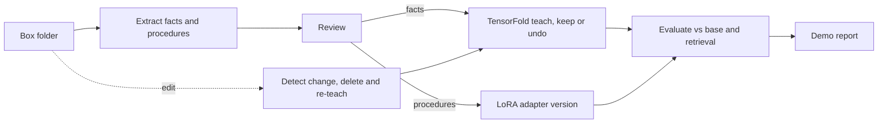

## Goal
A 1–2 day demo of a company that teaches its AI from its own Box documents: **facts** go into the model's weights with TensorFold, **procedures** go into a LoRA adapter, and both are tested against plain retrieval. Editing a document in Box updates what the model knows.

Research: [Training methods compared](research/training-methods-compared.md). Source: /Users/tyson/codebase/code-agents/sept/references/enterprise-learning-ranking-and-funding-2026-10-16.md

## Decisions (2026-10-16)
- Use case: **company knowledge** for a fictional company, replacing tech-support diagnostics.
- Two learning tracks plus Box: TensorFold for facts, LoRA for procedures, Box as the source of truth.
- Demo stories, all three: (a) jargon the model understands, (b) combining two facts, (c) Box edit updates the model. Plus (d) the facts-vs-procedures contrast: "On the X200, E42 means the fan failed" is a fact TensorFold can learn; "E42 plus high temperature: check airflow before replacing the fan" is a procedure, which needs LoRA.
- Training runs on a **cloud machine**, not the M4 Pro.

## Tasks

- [ ] [Cloud machine feasibility check for TensorFold and LoRA](tasks/01-cloud-machine-feasibility-check-for-tensorfold-and-lora.md)

- [ ] [Scaffold project and knowledge-pack schema](tasks/02-scaffold-project-and-knowledge-pack-schema.md)

- [ ] [Document source adapter for Box with local-folder fallback](tasks/03-document-source-adapter-for-box-with-local-folder-fallback.md)

- [ ] [Fictional company knowledge pack](tasks/04-fictional-company-knowledge-pack.md)

- [ ] [Retrieval and inference pipeline with baseline modes](tasks/05-retrieval-and-inference-pipeline-with-baseline-modes.md)

- [ ] [Review queue for extracted facts and procedures](tasks/06-review-queue-for-extracted-facts-and-procedures.md)

- [ ] [TensorFold fact teaching and Box sync](tasks/07-tensorfold-fact-teaching-and-box-sync.md)

- [ ] [LoRA procedure training and adapter registry](tasks/08-lora-procedure-training-and-adapter-registry.md)

- [ ] [Evaluation harness and promotion gate](tasks/09-evaluation-harness-and-promotion-gate.md)

- [ ] [End-to-end loop runner and demo script](tasks/10-end-to-end-loop-runner-and-demo-script.md)

## Execution waves
1. Cloud feasibility check (needs the machine from Tyson) and project scaffold, in parallel.
2. In parallel: Box source adapter, knowledge pack, retrieval + inference, review queue.
3. In parallel: TensorFold fact teaching + sync, LoRA procedure training, evaluation + gate.
4. End-to-end runner and demo.

A verifier checks each wave before the next starts.

## Acceptance Criteria
- A taught fact survives a server restart and is answered on wordings never used in training.
- The report compares base, retrieval, TensorFold and LoRA on identical held-out questions for each kind: jargon, single fact, two-fact, procedure, near miss, untold, unrelated.
- The facts-vs-procedures matrix shows, with numbers, whether TensorFold learned the E42 procedure and whether LoRA learned single facts.
- Editing the handbook (in Box when credentials exist, local folder otherwise) changes the learned answers after sync and restart.
- Every learned fact links to the source file and version it came from; undone facts are shown with TensorFold's reason.
- A LoRA version is promoted only if it beats retrieval on held-out procedure families without increasing drift; it reloads in a fresh process with the same outputs.
- `uv run pytest -q` passes locally without cloud or Box credentials.

## Non-goals
- Proving business value (fictional data proves the mechanism only).
- Tech-support diagnostics, public datasets, DPO or RL.
- Online per-request learning, production auth or deployment.

## Assumptions
- Cloud machine: an **AWS EC2 Mac with an M4 Pro and 48 GB** runs both TensorFold (MLX) and LoRA (MLX) on one host (confirm?). TensorFold is only tested on M3/M5 Ultra Macs and NVIDIA GB10; NVIDIA cloud GPUs other than GB10 are untested. EC2 Mac hosts bill a 24-hour minimum.
- LoRA base model: a small 4-bit instruct model (3–4B) for fast rounds; facts and procedures use different base models, so the tracks are compared side by side, not merged (confirm?).
- Box: developer token or CCG app via env vars; none configured yet, so the local folder is the default until provided (confirm?).
- Code is written locally in this repo; the remote host only serves and trains.

## Verification Plan
- `uv run pytest -q`
- `uv run python -m kloop data build`
- `uv run python -m kloop run --source local` against the remote host, then read the report
- `uv run python -m kloop demo`

## Rollback Plan
All work is on branch withered-cobra; revert commits or drop the branch. TensorFold lessons are undone with `tensorfold slide rollback` on the copied model folder.
